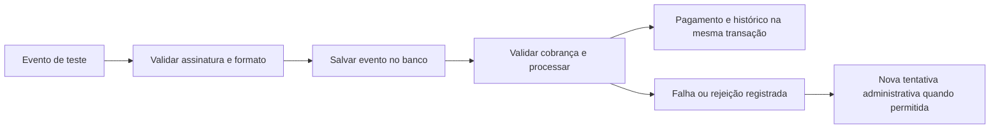

# Webhook Pix simulado — etapas 2 e 3

**SIMULAÇÃO — NÃO REALIZA PAGAMENTO.** Não há banco ou provedor externo conectado. O processamento é imediato e usa o serviço financeiro existente. Não foi criada fila, worker ou agenda adicional.



## Ativação

Somente `development` ou `test`, com `PIX_SIMULATOR_ENABLED=true` e `PIX_WEBHOOK_TEST_SECRET` exclusivo, com pelo menos 32 caracteres. Não reutilize os segredos de JWT, Redis ou PostgreSQL; a configuração recusa esse reuso. Produção continua bloqueada. O segredo não é enviado ao navegador nem incluído nas respostas ou registros dos eventos.

O `.env` da aplicação não foi alterado. `compose.business-tests.yaml` ativa o recurso exclusivamente no ambiente descartável, com segredo conhecido de testes, banco próprio e rede interna sem portas públicas. O frontend desse ambiente não recebe o segredo; somente o backend e o processo Node do teste de navegador o recebem.

## Contrato da requisição

`POST /webhooks/pix/simulated`, sem JWT de usuário. A autenticação exige dois headers:

- `X-Pix-Test-Timestamp`: Unix timestamp atual em segundos, decimal com 10 dígitos.
- `X-Pix-Test-Signature`: `sha256=<HMAC-SHA256 hexadecimal minúsculo>`.

Mensagem assinada: **timestamp + ponto + bytes originais do corpo**, usando o segredo exclusivo em UTF-8. A comparação usa `hmac.compare_digest`. O timestamp de transporte deve estar a no máximo 300 segundos do relógio UTC do servidor. Essa regra é independente da data de ocorrência do evento.

Corpo JSON de até 16.384 bytes, sem chaves duplicadas, constantes não finitas ou campos adicionais. UUIDs abaixo são ilustrativos; substitua pelos dados da cobrança de teste:

```json
{
  "schema_version": 1,
  "event_id": "11111111-1111-4111-8111-111111111111",
  "event_type": "payment.confirmed",
  "is_simulated": true,
  "charge_id": "22222222-2222-4222-8222-222222222222",
  "reference": "TEST-PIX-22222222-2222-4222-8222-222222222222",
  "amount_cents": 15000,
  "currency": "BRL",
  "external_payment_id": "TEST-PAY-33333333-3333-4333-8333-333333333333",
  "occurred_at": "2026-11-10T12:00:00Z"
}
```

`schema_version` exige inteiro 1; `is_simulated` exige booleano `true`. Valores são inteiros positivos em centavos. `occurred_at` precisa incluir fuso e é normalizado para UTC.

Tipos suportados:

| Tipo | Referência de pagamento | Comportamento |
| --- | --- | --- |
| `payment.confirmed` | Obrigatória, prefixo `TEST-PAY-` | Aplica quitação somente após validar referência, valor, moeda, datas e estado |
| `charge.pending` | Ausente | Indicação informativa; não reabre nem regride cobrança |
| `charge.cancelled` | Ausente | Cancela tentativa pendente; não desfaz pagamento ou cancela mensalidade |

Código real de provedor, assinatura real e estados reais exigirão adaptador e regras próprios. Esse HMAC constitui apenas o contrato do simulador.

## Persistência, transações e idempotência

`webhook_events` guarda payload normalizado, hash SHA-256, ID externo, origem, estado, contadores, datas e vínculos financeiros. Segredo, assinatura e headers completos não são armazenados. Solicitações não autenticadas ou com formato inválido são recusadas antes de entrar nessa tabela.

O ID externo é único por origem. O hash representa o conteúdo normalizado, não a formatação do JSON; diferenças apenas de espaços/ordem de chaves não criam conflito. Para alterar conteúdo é necessário um novo ID. Reusar o mesmo ID com conteúdo diferente retorna 409, conserva o evento original e registra contagem e hash da última divergência.

1. A transação de recebimento confirma o evento antes da liquidação.
2. Outra transação bloqueia o evento, depois mensalidade e cobrança, e aplica as regras existentes.
3. Pagamento, estados financeiros, resultado e histórico do processamento são atômicos.
4. Em caso de falha, a transação financeira é revertida. A falha é registrada em uma nova transação, com código seguro, sem texto bruto da exceção.

Se o banco falhar também ao registrar o erro, o evento inicialmente recebido permanece salvo como `received`; após recuperar o banco, ele pode ser retomado. Uma interrupção entre receber e processar tem o mesmo tratamento. Não há agendamento automático para buscar pendências.

`delivery_count` conta entregas autenticadas do ID; `conflict_count` conta conteúdos conflitantes; `attempt_count` conta tentativas cujo resultado pôde ser registrado. Uma interrupção completa ou indisponibilidade de gravação pode impedir o registro da tentativa, mantendo o recebimento original como evidência.

Repetir entrega processada não cria outra quitação. Outro ID de evento para o mesmo recebimento é ignorado após conferir a identidade do pagamento. Outra referência de pagamento para a mesma mensalidade é rejeitada. A restrição única em `payments.monthly_fee_id` continua protegendo os canais manual e Pix.

## Estados e respostas

| Estado | Significado | Nova tentativa administrativa |
| --- | --- | --- |
| `received` | Guardado, sem processamento concluído | Permitida |
| `processed` | Ação aplicada | Bloqueada |
| `ignored` | Evento válido sem nova alteração, como confirmação repetida ou status antigo | Bloqueada |
| `rejected` | Divergência de negócio ou estado incompatível | Bloqueada; analisar e corrigir a origem, sem editar o evento |
| `failed` | Falha técnica, sem quitação parcial | Permitida após resolver a causa |

HTTP 200: processado/ignorado. HTTP 202: guardado, mas rejeitado ou com falha; **não significa pagamento confirmado**. A resposta inclui o estado e o código seguro do erro. Autenticação inválida retorna 401; excesso de tamanho, 413; formato inválido, 422; conteúdo conflitante para o mesmo ID, 409. Recurso desativado retorna 404. Falhas de persistência podem retornar 503.

Repetir uma entrega `failed` conserva a falha e não dispara nova tentativa oculta. Uma entrega repetida `received` pode retomar o processamento interrompido. Isso mantém a recuperação simples e observável.

## Datas e eventos fora de ordem

A ocorrência não pode anteceder a criação da cobrança nem exceder o relógio do servidor em mais de 60 segundos. Confirmação ocorrida após a expiração é rejeitada. Nesta simulação, uma confirmação entregue depois da expiração de uma cobrança ainda não paga também é registrada para análise, sem liquidação automática.

Uma pendência/cancelamento posterior à confirmação não desfaz quitação. Cancelamento seguido de confirmação não reabre cobrança. Mensalidade cancelada não recebe baixa automática. Atraso de entrega, data de liquidação bancária e devoluções reais dependerão das regras do futuro provedor; não há descarte de evidência nem devolução automática nesta implementação.

## Administração

| Método | Caminho | Uso |
| --- | --- | --- |
| GET | `/admin/pix/events` | Listar com `status` opcional, `offset` e `limit` até 200 |
| GET | `/admin/pix/events/{id}` | Consultar payload validado, resultado e contadores |
| POST | `/admin/pix/events/{id}/retry` | Retomar `received` ou `failed`, com corpo `{"reason":"Causa da falha resolvida"}` |

Essas rotas exigem JWT de administrador ativo, não a assinatura do simulador. A nova tentativa usa o payload preservado, sem aceitar alteração de valor, referência ou status. Seu administrador e motivo são registrados em `audit_events`; a liquidação permanece atribuída ao sistema simulado. Leituras e respostas de webhook recebem `Cache-Control: no-store`.

Não foi criada tela dedicada aos eventos. A administração é pela API; o painel existente mostra **Concluída (simulação)** ao consultar a mensalidade confirmada. O teste de navegador cobre essa apresentação.

## Verificação reproduzível e migração

`backend/tests/test_webhooks.py` cobre o fluxo básico. `backend/tests/test_webhook_adversarial.py` cobre ataques, divergências, atrasos, concorrência, falhas e recuperação. `frontend/e2e/pix.spec.js` demonstra a assinatura com `node:crypto`, sem SDK, entrega repetida e apresentação no painel.

A revisão `20261110_04` cria somente a tabela/índice de eventos. Não modifica revisões anteriores. Seu downgrade é bloqueado quando existem eventos, para preservar o histórico.

O ambiente de navegador usa as imagens de teste locais já disponíveis:

```sh
docker compose -p academia-business-tests -f compose.business-tests.yaml up -d redis backend frontend
docker compose -p academia-business-tests -f compose.business-tests.yaml run --rm e2e
docker compose -p academia-business-tests -f compose.business-tests.yaml down --volumes
```

Esse projeto e volume são exclusivos de testes. O segredo conhecido nessa composição não deve ser reutilizado em outro ambiente. As migrações desta entrega foram aplicadas somente em bancos descartáveis; a implantação no servidor atual exige autorização própria.
